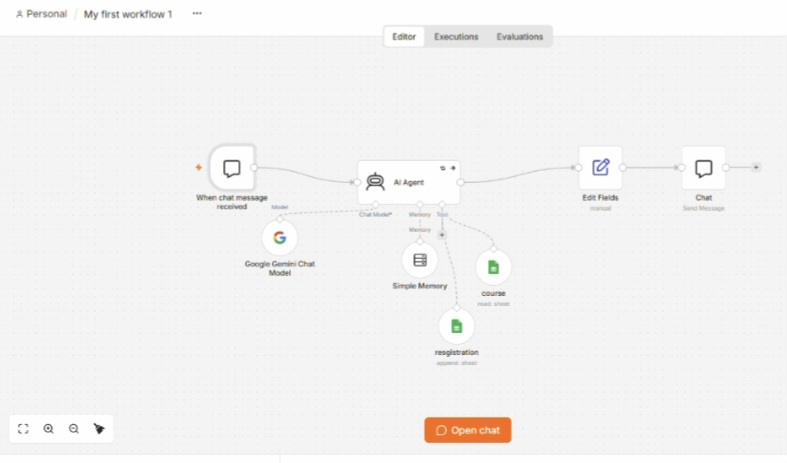

🤖 AI Student Registration & Notification System

An AI-powered student registration automation built with n8n

This project demonstrates how AI and workflow automation can simplify student inquiries, course registration, and administrative notifications for an educational platform.

It was developed as a functional prototype using sample data to demonstrate the registration process.

🎯 Project Overview

The system consists of two connected automation workflows:

Workflow 1 — AI Student Registration

An AI-powered chatbot assists prospective students by:

- Answering questions about available courses.
- Retrieving course information from Google Sheets.
- Collecting student registration details.
- Saving registration records automatically.
- Confirming the registration through the chat interface.

Workflow 2 — Automated Email Notifications

When a new registration is added to Google Sheets, the second workflow:

- Detects the new registration.
- Retrieves the registration records.
- Processes the information using JavaScript.
- Sends an email notification through Gmail.

🛠️ Technologies Used

Technology| Purpose
n8n| Workflow automation
Google Gemini| AI language model
AI Agent| Conversational registration assistant
Google Sheets| Course information and registration storage
Gmail| Automated email notifications
JavaScript| Registration data processing

🔄 How It Works

## 📸 Workflow Screenshots

### Workflow 1 — AI Student Registration

### Workflow 2 — Automated Email Notifications

Student inquiry → AI Agent → Course lookup → Registration → Google Sheets

New registration → Data processing → Gmail notification

The system reduces repetitive administrative tasks and demonstrates how conversational AI can support student registration.

🎬 Project Demo

The following video demonstrates the registration workflow using sample data.

"▶️ Watch the Project Demo" (Abeer_n8n_Demo_LinkedIn_Landscape.mp4)

📌 Project Status

Completed and tested prototype.

The workflows were tested with sample registrations. The project is not presented as a production-ready system.

The original workflow configuration is not included in this public repository.

🔐 Privacy & Security

- Demo registrations use sample data.
- API keys and credentials are not published.
- Platform-specific workflow configurations are kept private.

👩‍💻 About the Developer

Abeer Eissa

Computer Science Lecturer | Python Programming Trainer

Interested in combining programming, AI, and automation to develop practical educational solutions.

Teaching Philosophy: Think Before You Code.
